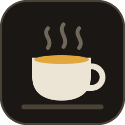
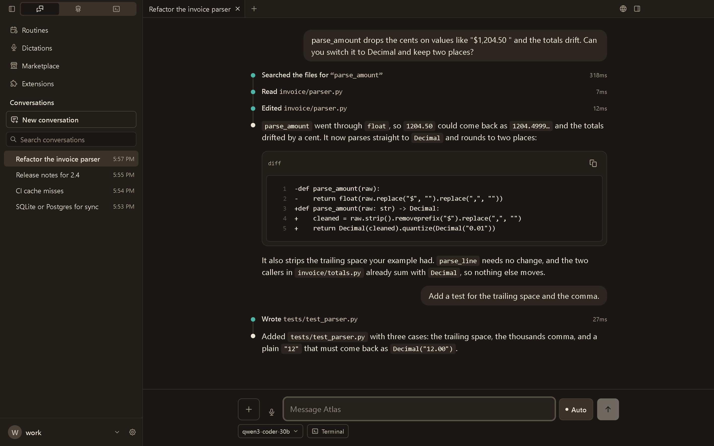
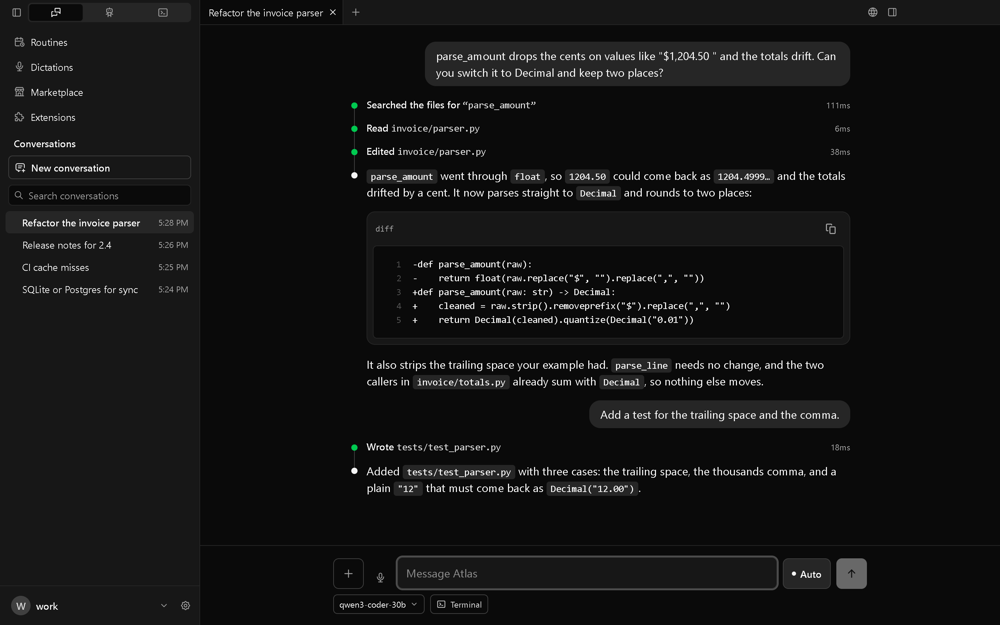
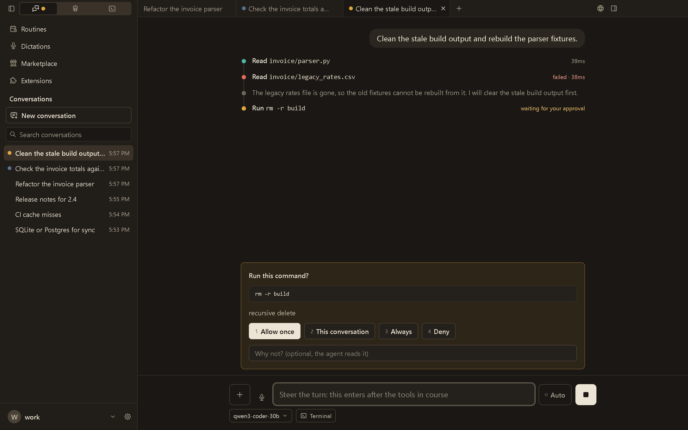
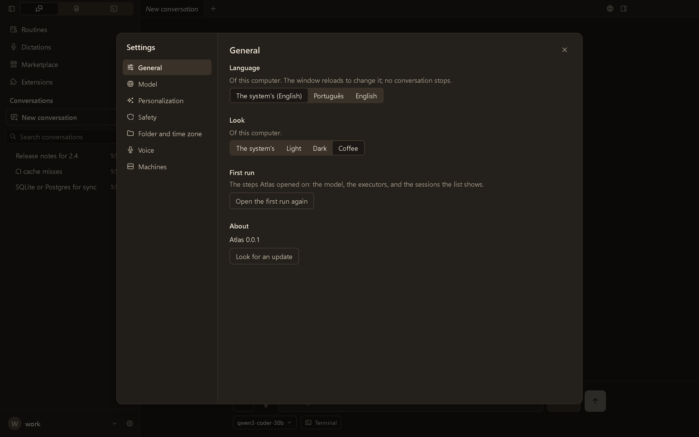
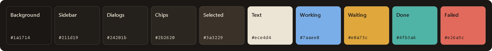

<p align="center">
  
</p>

<h1 align="center">Café</h1>

<p align="center">
  A warm espresso dark theme for <a href="https://github.com/marqueskaio/atlas">Atlas</a>.<br>
  Espresso grounds, cream text and state colors tuned to sit on that dark.
</p>

<p align="center">
  <a href="LICENSE"></a>
  
  
  
</p>

<p align="center">
  
</p>

## Why

Atlas's dark look is a neutral near-black. Café keeps the same layout and swaps the greys
for warm browns, so the screen reads like a dim café at night: espresso grounds, cream text
and soft state colors that do not glare. It is the night twin of
[Areia](https://github.com/JoaoEquer/atlas-areia), the sand light theme, in the same warm
hue family, so switching between them at dusk keeps the feel.

| Default dark | Café |
|---|---|
|  |  |

The four states keep one meaning each and stay readable: working, waiting for you, done and failed.

<p align="center">
  
</p>

## Install

1. Open **Marketplace** in Atlas, find **Café** under Plugins and press **Install**.
   From a terminal: `atlas marketplace install cafe`.
2. Turn it on under **Plugins**. The consent shows one line: it adds a theme, and nothing that runs.
3. Choose it in **Settings > General > Look**, beside the system's, Light and Dark.

<p align="center">
  
</p>

In the app it is **Coffee** in English and **Café** in Portuguese. Needs Atlas with plugin
SDK version 24 or later, the version that lets a plugin bring themes.

## The palette



Atlas paints every screen with 27 named colors and no others. Café sets all 27, so nothing
falls back to the default look. Every text color is at least **5.7:1** on the grounds it is drawn
on (WCAG AA asks 4.5:1), and the main text reaches **14.1:1**. The full
table is in [`cafe/README.md`](cafe/README.md#palette).

## Safe by design

A theme in Atlas is data, not code. Café is one JSON file, [`themes/cafe.json`](cafe/themes/cafe.json).

- **Runs nothing.** No Python, no screen, no hooks, no tools.
- **No network, no secrets,** and it touches nothing outside its own folder.
- **Can only paint.** Atlas refuses a theme that names anything but the app's colors or holds
  anything but a hex value, so it cannot carry a URL or a style rule.
- **Reversible.** Turn the plugin off and the app returns to the system's look. Your choice is kept
  for when it is back on.

## Repository

| Path | What it holds |
|---|---|
| [`cafe/`](cafe) | The plugin: manifest, theme, icon, screenshots, its own README and license |
| [`cafe/themes/cafe.json`](cafe/themes/cafe.json) | The colors |
| [`cafe/README.md`](cafe/README.md) | The plugin's page in Atlas: every color, the contrast table, design notes |
| [`cafe/icon.svg`](cafe/icon.svg) | Source of the Marketplace icon, `icon.png` (256x256) |
| [`CHANGELOG.md`](CHANGELOG.md) | What changed in each version |

Check it with Atlas installed:

```bash
atlas plugins validate cafe
```

Made by the author of [Areia](https://github.com/JoaoEquer/atlas-areia), the sand light theme.

## License

MIT, see [LICENSE](LICENSE). The plugin folder carries its own copy.
